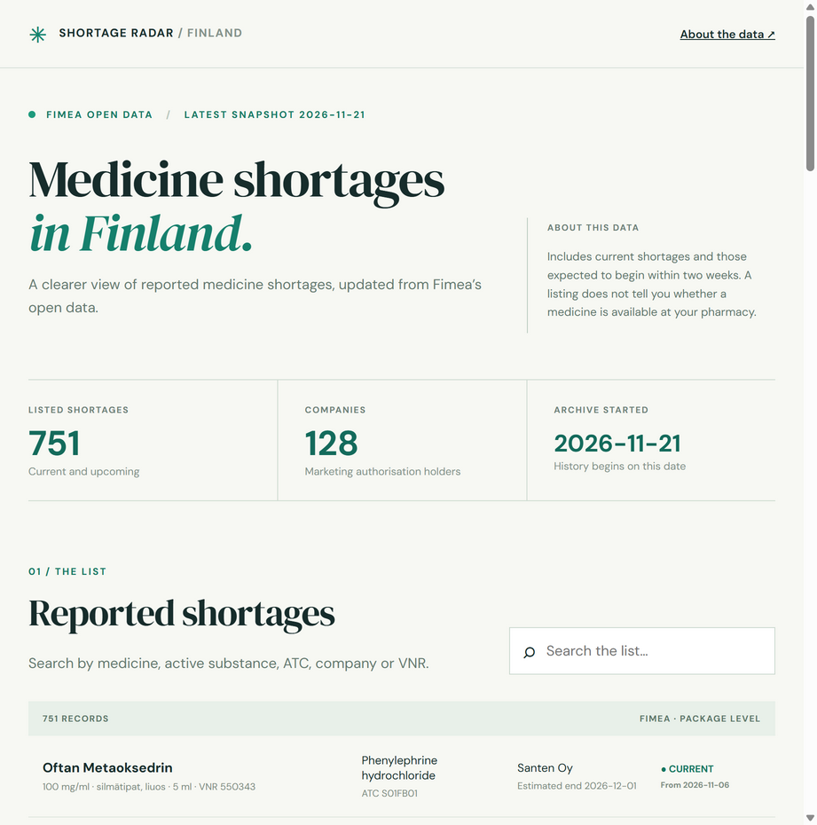

# Shortage Radar

A daily archive and static dashboard of reported medicine shortages in Finland. Fimea's open shortage file contains current shortages and those expected within two weeks; it is not a public historical archive. This project captures changes so that the list can be studied over time.



**Not medical advice. Ask a pharmacist or doctor about your medicines.** A listing does not establish availability at a particular pharmacy or recommend a substitute.

## Dashboard and data

The dashboard searches names, substances, ATC codes, companies and package VNRs. It counts records by ATC group and company and charts saved snapshots. History begins on **21 November 2026**: no earlier trend should be inferred. The delays section waits for at least 28 days and 10 observed removals with initial estimates; it compares estimates to removal from the list, not a confirmed return to supply.

The first capture has 751 rows, 743 matched product names and 8 unmatched VNRs: `422093`, `433660`, `522103`, `531797`, `541749`, `572154`, `583857`, `584836`. Names are joined to the current register and may not describe historical products as they were at the time. The basic register was chosen because Fimea publishes a direct, nightly updated XML download with package, product and substance references; no account or catalogue lookup is needed. It is large (about 200 MB), but is streamed during processing and not committed.

Fimea also publishes a [machine-readable interchangeable-products list](https://fimea.fi/laakehaut_ja_luettelot/laakevaihto/tietokantaan_ladattava_tiedosto). Its Q4 2026 groups are included in the dataset as `listed_substitution_group` (590 current records match). They are not recommendations: Fimea states that the group alone does not establish package-size interchangeability. Update the quarterly source and its `interchangeable-metadata.json` validity dates and attribution together. Builds warn and omit the group codes outside the configured validity period. The dashboard does not suggest alternatives.

The 2025-09-27 Internet Archive capture was attempted using the raw `id_` URL and returned HTTP 404, so it was not imported.

## How it works

The scheduled GitHub Action downloads and validates the Fimea file, saving a dated file only if its bytes changed. It rejects files with fewer than 100 rows or less than half the previous snapshot's row count. A run fails on an invalid file, network failure, or conflicting capture on the same date. Changed snapshots trigger the Pages workflow, which downloads the current basic register and builds `site/data.json` as a deployment artifact; the generated data is not committed. Pushes to main also build and deploy Pages. Enable GitHub Pages with **GitHub Actions** as the source after the repository becomes public. GitHub Actions must have permission to write repository contents, and scheduled workflows and Pages depend on repository settings and plan.

An event is identified by VNR, reported start date, notification date and company. Changes to these identifying fields can appear as a removal and a new event. The output records first and last seen dates, initial estimated end, changes in that estimate, and the first saved snapshot without the record. A missing record is an **observed removal**, not a medically confirmed real end. Since identical downloads are not saved, last seen is the last *saved* snapshot, not necessarily the last successful daily check; a removal may have occurred anywhere after that snapshot and on or before the next saved one. Gaps and failed runs widen the uncertainty. The chart shows saved snapshots rather than interpolating missing days. Fimea's feed excludes products without VNRs and some other shortages; consult Fimea for the full limitations.

## Run locally

Python 3.12 is recommended. On Windows, install `tzdata` for the Helsinki time zone. `pytest` is needed for tests; the processing code otherwise uses the standard library.

```sh
python -m pip install pytest tzdata
python scripts/archive.py
python scripts/fetch_register.py
python scripts/build.py
python -m pytest -q
python -m http.server 8000 --directory site
```

Open `http://localhost:8000/`. The local HTTP server is only for preview: the site itself is static. The archive command downloads current public Fimea data and writes this repository's data files. Update the quarterly interchangeable list deliberately from Fimea when its period changes.

## Attribution and licence

Data is provided by the **Finnish Medicines Agency Fimea**, under [CC BY 4.0](https://creativecommons.org/licenses/by/4.0/). Fimea's [open data page](https://fimea.fi/en/about_us/open-data) describes the datasets and licence. This project transforms and joins the source data, derives events and counts, and displays a subset; it is not endorsed by Fimea. Source modification timestamps below are the HTTP `Last-Modified` timestamps, not necessarily the publisher's release time. Latest observed timestamps for the first build:

| Dataset | Source | Source last modified (UTC) | Changes |
| --- | --- | --- | --- |
| Supply shortages | [Shortages.txt](https://data.pilvi.fimea.fi/avoin-data/Shortages.txt) | 2026-11-20 23:20:01 | Archived, parsed, joined and aggregated |
| Basic register of medicinal products | [XML and documentation](https://fimea.fi/en/databases_and_registers/basic-register-xml) | 2026-11-21 00:30:41 | Selected package, product and substance fields joined by VNR |
| Interchangeable medicinal products, 1 October–31 December 2026 | [Fimea list and documentation](https://fimea.fi/laakehaut_ja_luettelot/laakevaihto/tietokantaan_ladattava_tiedosto) | 2026-08-24 11:55:28 | Selected group codes joined by VNR |

The most recent snapshot's shortage timestamp is in [`data/source/metadata.json`](data/source/metadata.json); the basic-register timestamp is captured during each build. The dashboard displays both along with the interchangeable-list timestamp. The interchangeable list is the dated Q4 copy described above. Source release times beyond these HTTP timestamps were not available from the files.
