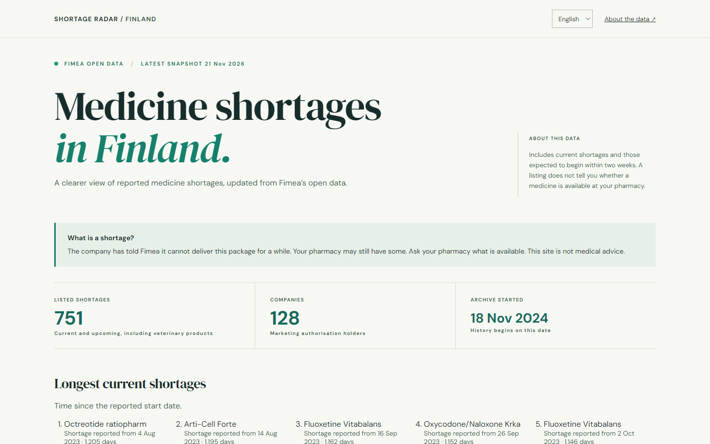
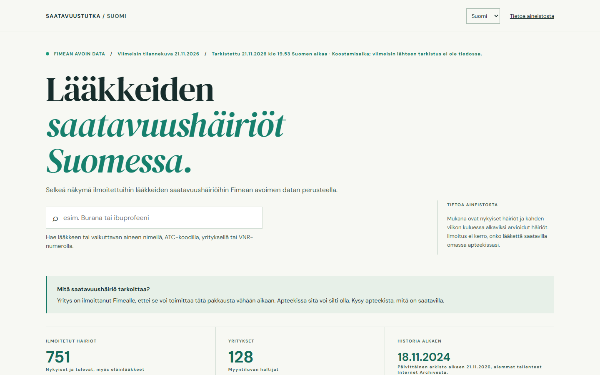
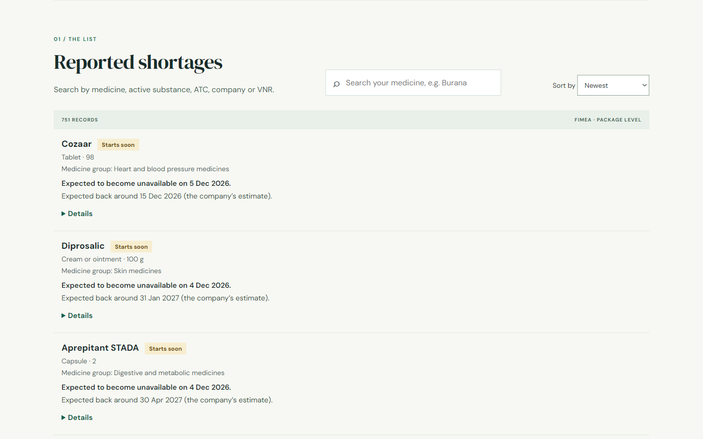
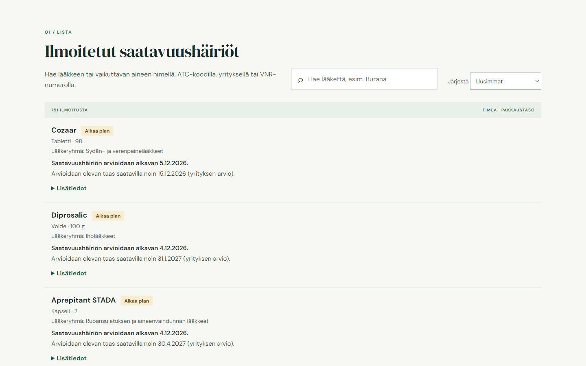

# Shortage Radar

[Open the live site](https://alejandrorenalias.github.io/shortage-radar/) · Saatavuustutka in Finnish

Shortage Radar is a searchable view and archive of reported medicine shortages in Finland. Fimea's open file describes current shortages and those expected within two weeks, but Fimea does not provide a public history of that file. This project saves captures to make changes over time visible. Daily archive since 21 Nov 2026, with earlier captures from the Internet Archive.









**This is not medical advice.** A listing does not establish whether a medicine is available at a particular pharmacy. Ask a pharmacist or doctor about your medicines.

## How it works

A scheduled job downloads and validates Fimea's shortage file and saves a dated snapshot when its contents change. The site joins package records to the current basic register by VNR and builds a static dashboard. It can be searched by medicine, strength, substance, ATC, company or VNR; it includes veterinary products. Earlier copies from the Internet Archive extend the timeline. The download links on the site provide the current dataset.

The archive checks Fimea four times daily at 04:35, 10:05, 15:35 and 21:05 UTC to reduce the chance of a missed day. A separate Pages build runs daily at 04:55 UTC as a safety net. When a scheduled or manual workflow starts more than 30 hours after the last successful archive check, it raises a data-pipeline issue until an archive check succeeds. If GitHub starts no workflows at all, that alert will be late; the site itself shows a stale-data warning after more than three days.

The dashboard first loads `current.json` for the list, then loads `history.json` for the chart and analysis. The downloadable `data.json` retains the complete event history. `week.json` holds the counts for the "This week" summary, and `feed.xml` (English) and `feed-fi.xml` (Finnish) are Atom feeds of the shortages that appeared or left the list in the last 14 days, with at most 200 entries.

The CSV uses UTF-8 with a BOM and contains package, medicine, company, date and veterinary fields. The JSON records the UTC build time as `generated_at` and the most recent successful archive check date as `last_checked`, which can be empty. When that date is unavailable, the site labels the build-time fallback and does not imply that the source was checked at build time.

The history shows saved captures, not daily observations. Capture gaps can be long: the first is from 18 November 2024, followed by a gap until September 2026. The chart does not interpolate across long gaps. An event is identified by VNR, reported start, notification date and company; changes to those fields can appear as a removal and a new event.

The comparison with estimated end dates uses only events with sufficiently close captures at both ends. It describes when a record was last seen or removed from the list, not when supply actually returned. Estimates may already have changed before the first available capture, and ongoing shortages are excluded from the comparison.

## Sources and limits

The source data is from the [Finnish Medicines Agency Fimea](https://fimea.fi/en/about_us/open-data), including its shortage file and [basic register of medicinal products](https://fimea.fi/en/databases_and_registers/basic-register-xml). Earlier captures of the shortage file and RSS feed were retrieved from the [Internet Archive](https://web.archive.org/). The project selects, joins and transforms the data; it is not endorsed by Fimea. Register names and details are current at build time and may not describe historical products as they were then. Some packages may not match the register. Fimea's file does not include all shortages, including products without VNRs.

Source times on the site are file modification times, not necessarily publication times. A missing record is an observed removal, not proof that a shortage ended or that a product is available. See [`data/snapshots/imported/manifest.json`](data/snapshots/imported/manifest.json) for the imported captures and omissions.

## Run locally

Python 3.12 is recommended; Windows needs `tzdata` for the Helsinki time zone. The register download is large and the archive commands write local data files.

```sh
python -m pip install pytest tzdata
python scripts/archive.py
python scripts/import_history.py
python scripts/fetch_register.py
python scripts/build.py
python -m pytest -q
node --test tests/test_dashboard.cjs
python -m http.server 8000 --directory site
```

Open `http://localhost:8000/` to preview the static site.

## Licence and citation

Code is licensed under the [MIT License](LICENSE). Fimea data is licensed under [CC BY 4.0](https://creativecommons.org/licenses/by/4.0/). DM Sans and DM Serif Display are locally hosted under the SIL Open Font License; the licence texts are in [`site/fonts`](site/fonts/).

Suggested citation: Alejandro Renalias, *Shortage Radar*, https://alejandrorenalias.github.io/shortage-radar/ (data dated [data date], accessed [date]); data from the Finnish Medicines Agency Fimea, CC BY 4.0, selected, joined and transformed; earlier captures from the Internet Archive.
